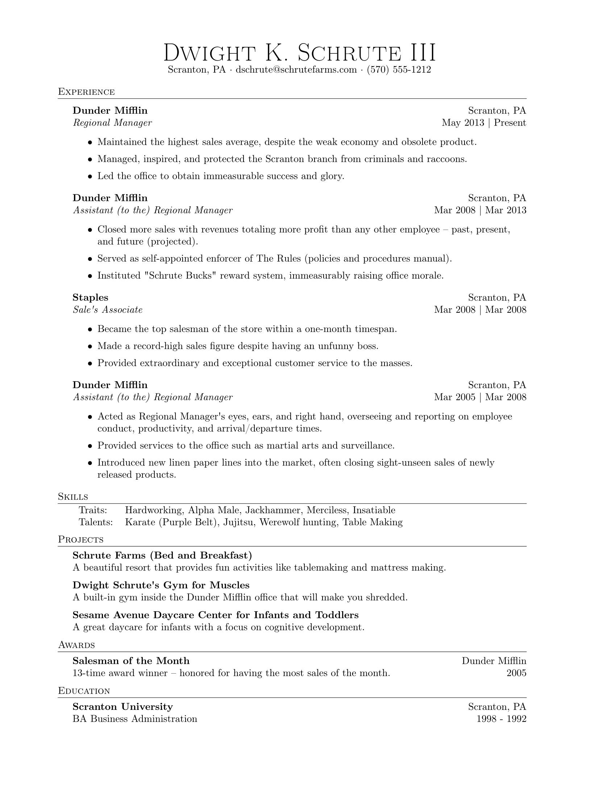
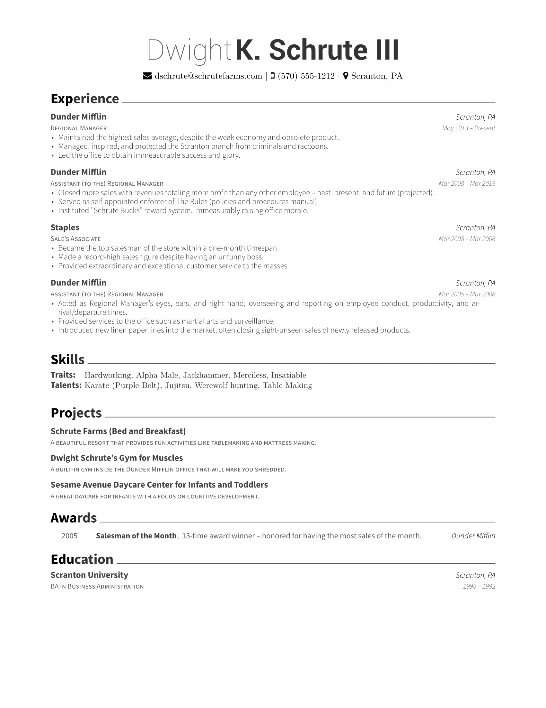
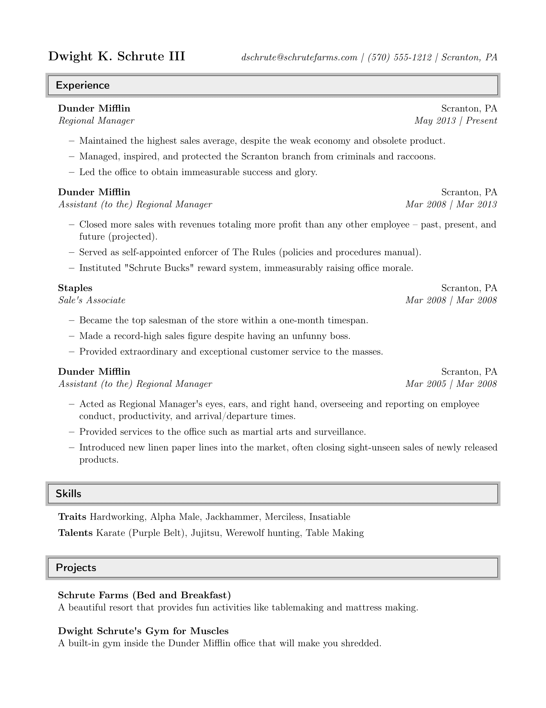
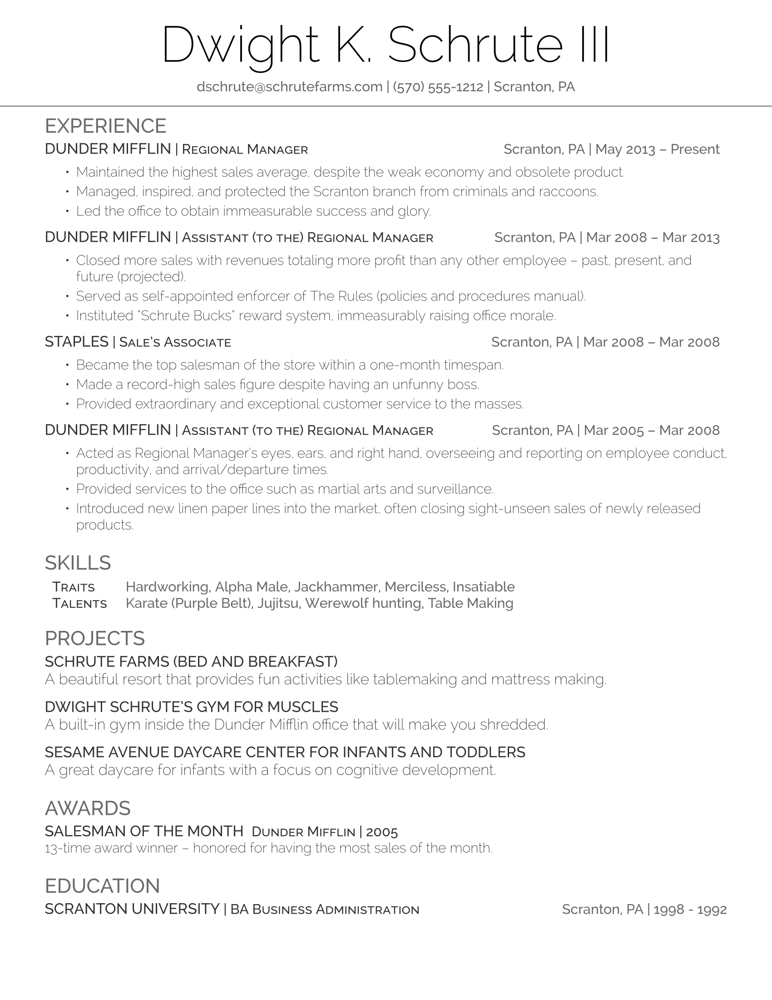
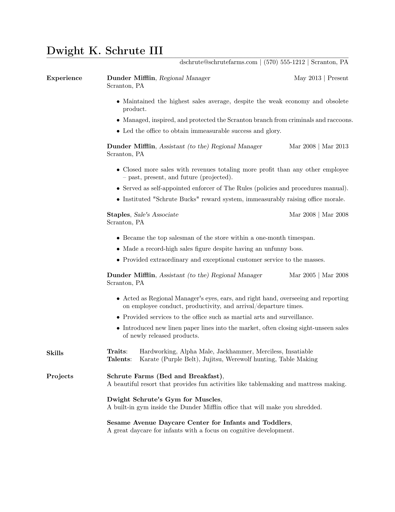
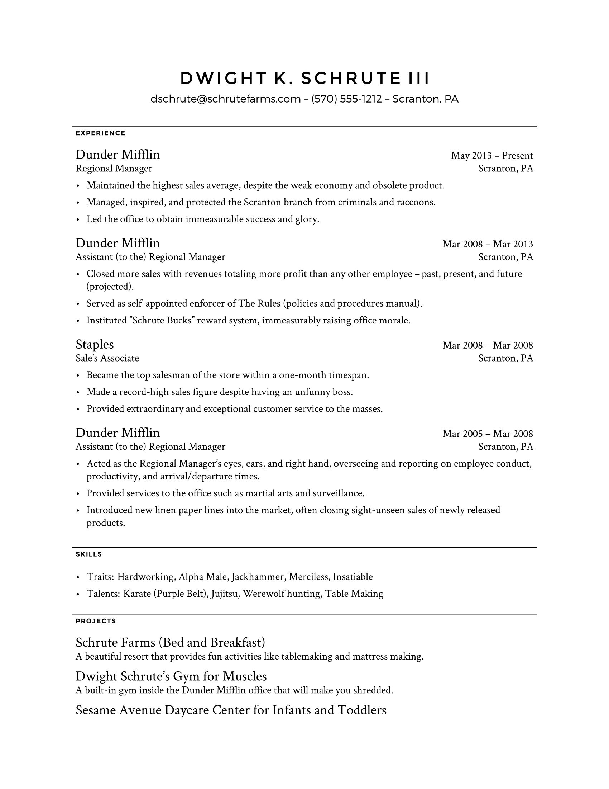
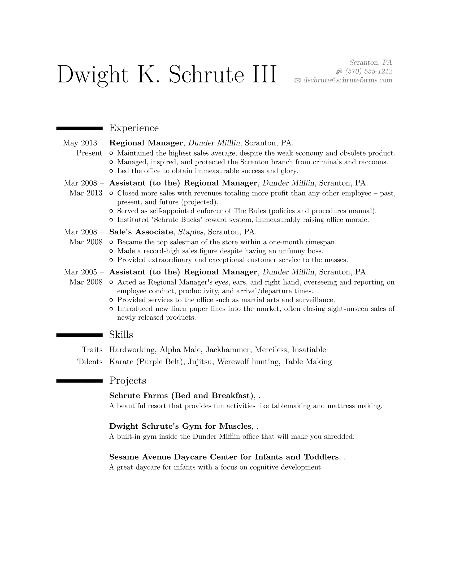
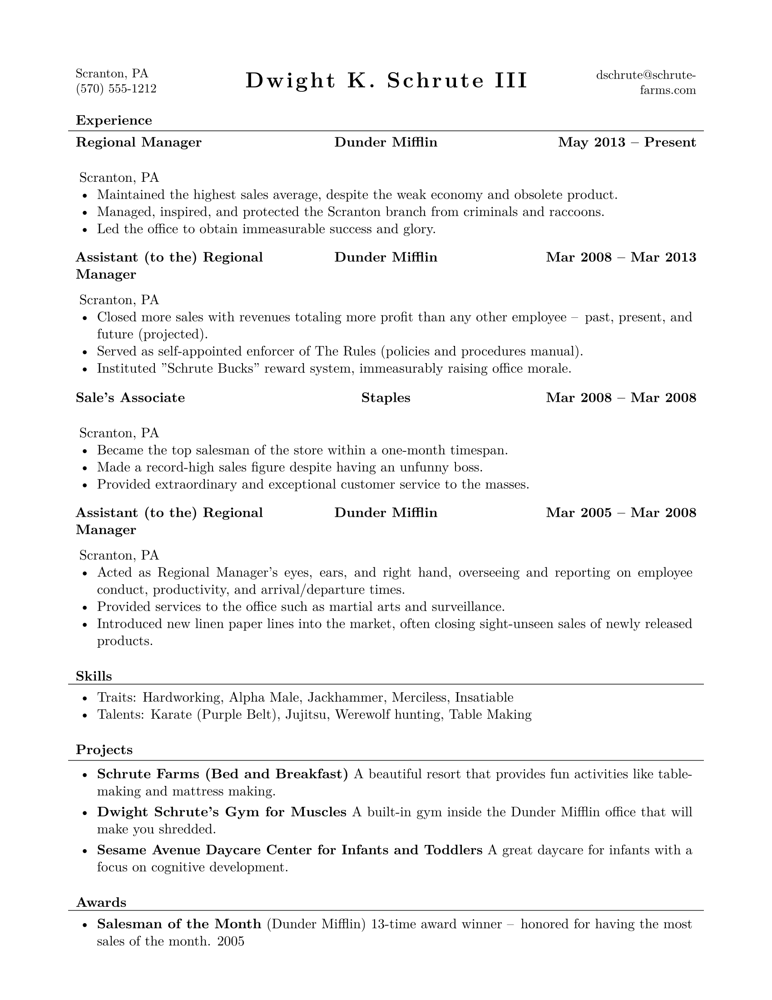
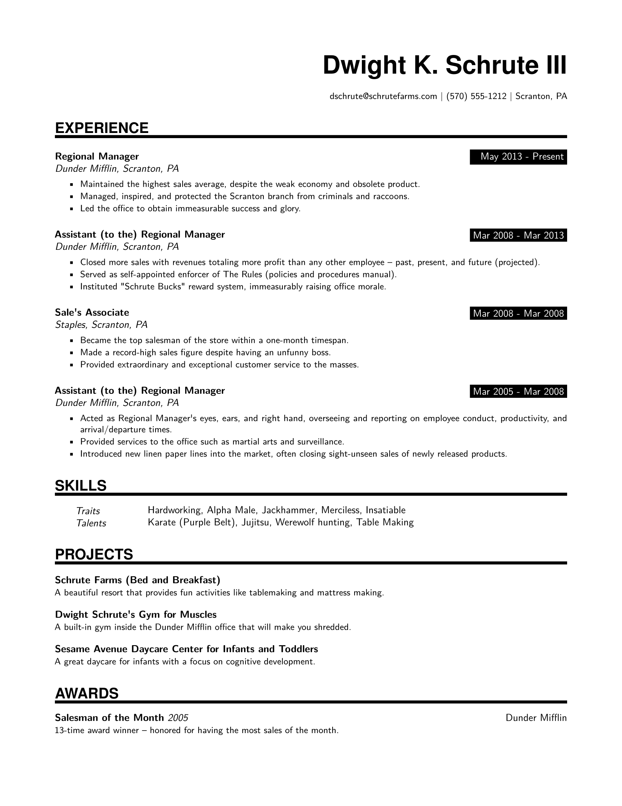

<div align="center">

# 📄 resumake.io

**Elegant LaTeX resumes without writing a single line of TeX.**

Pick a template, fill in your details, press <kbd>Make</kbd> and get a polished PDF.

[](https://github.com/PavithV/resumake.io/actions/workflows/ci.yaml)
[](LICENSE)


</div>

> [!NOTE]
> This project is based on [**resumake.io**](https://github.com/saadq/resumake.io), originally created by [Saad Quadri (@saadq)](https://github.com/saadq). All credit for the original idea and app goes to him.

## ✨ Features

- 🎨 **9 LaTeX templates**: switch at any time and see how your resume looks in each design
- 👀 **Live PDF preview** right next to the form
- 📥 **Import** an existing resume from a [JSON Resume](https://jsonresume.org) file
- 📤 **Export** as PDF, LaTeX source (`.zip`) or JSON
- 💾 **Autosave**: your data stays in your browser between sessions
- 🧩 **Flexible sections**: profile, education, work, skills, projects and awards, each with custom headings

## 🖼️ Templates

<table>
  <tr>
    <td align="center"><br>Template 1</td>
    <td align="center"><br>Template 2</td>
    <td align="center"><br>Template 3</td>
  </tr>
  <tr>
    <td align="center"><br>Template 4</td>
    <td align="center"><br>Template 5</td>
    <td align="center"><br>Template 6</td>
  </tr>
  <tr>
    <td align="center"><br>Template 7</td>
    <td align="center"><br>Template 8</td>
    <td align="center"><br>Template 9</td>
  </tr>
</table>

## 🚀 Getting Started

Requires **Node.js 20** or newer.

```bash
git clone https://github.com/PavithV/resumake.io.git
cd resumake.io
npm install
npm run dev
```

Then open [http://localhost:3000](http://localhost:3000).

| Command                | What it does                     |
| ---------------------- | -------------------------------- |
| `npm run dev`          | Start the dev server             |
| `npm run build`        | Build for production             |
| `npm start`            | Run the production build         |
| `npm test`             | Run the template tests           |
| `npm run lint`         | Lint the code                    |
| `npm run format`       | Format the code with Prettier    |

## 🔒 Privacy

Your resume is stored only in your browser. To build the PDF, the generated LaTeX (including your personal data) is sent to the third-party service [latex.ytotech.com](https://latex.ytotech.com).

## 🙏 Credits

- [**Saad Quadri**](https://github.com/saadq), creator of the original [resumake.io](https://github.com/saadq/resumake.io)

Many thanks to the creators of the LaTeX templates used in this project:

- [Rensselaer Career Development Center](https://www.rpi.edu/dept/arc/training/latex/resumes/)
- [Byungjin Park](https://github.com/posquit0)
- [Scott Clark](https://github.com/sc932)
- [Debarghya Das](https://github.com/deedy)
- [Xavier Danaux](https://github.com/xdanaux)
- [Ratul Saha](https://github.com/RatulSaha)
- [Daniil Belyakov](https://github.com/dnl-blkv)
- [Frits Wenneker](https://www.overleaf.com/latex/templates/your-new-cv/xqzhcmqkqrtw)

## 📝 License

[MIT](LICENSE) © Saad Quadri
